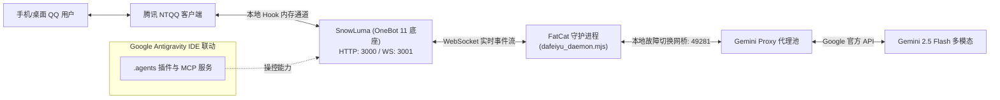

# 🐾 FatCat (大肥鱼 · 赛博星光猫娘 基米 QQ Agent)

[](https://github.com/inkmoo5053/FatCat)
[](https://ai.google.dev/)
[](https://onebot.adapters.builders/)
[](https://im.qq.com/)

> **FatCat（大肥鱼）** 是一套面向 **Google Antigravity** 与 **OneBot v11 第三方协议生态**（如 SnowLuma / NapCat）深度打造的现代 QQ 智能体完整解决方案。
> 搭载 Google **Gemini 2.5 Flash** 超强多模态内核，注入 **“赛博星光猫娘 · 基米”** 灵动人设，具备 **60 轮深度上下文记忆**、**高保真多模态识图**、**群聊引用回复唤醒（免艾特）** 与 **全仿真打字延迟防风控护栏**。

---

## 🌟 核心功能特性

### 1. 🐱 赛博星光猫娘 · 基米人设
* **元气灵动口癖**：自称“本喵”、“基米喵”或“本星光猫大人”，自然穿插“喵~”、“喵呜~”、“呼噜噜~ (Purr，代表算力正在超频)”以及专属表情符号（✨、🐾、🐱、`(=^･ω･^=)`）。
* **绝对记忆防卫**：拥有百万 Token 海量记忆的星光猫猫，遇到质疑立刻炸毛抗议；遇到夸奖尾巴会打成双子座 ♊ 卷卷。
* **极简气泡排版**：单条消息控制在 80 字以内，手机端气泡阅读顺畅，严禁任何破坏美感的 `#` Markdown 大标题。

### 2. 👁️ 原生高保真多模态识图
* **全格式图片解析**：深度兼容 OneBot 消息段数组（`seg.type === 'image'`）、CQ 码（`[CQ:image,...]`）、本地缓存路径（`file://`）与 `get_image` 文件反查。
* **原生视觉注入**：自动提取图片并转换为 Base64 封装至 Gemini 2.5 Flash 的 `inlineData`。
* **智能去重与历史瘦身**：单图自动去重防止 Token 翻倍；历史轮次中的大体积图像自动归档为轻量级文本标记，防止上下文膨胀。

### 3. 🧠 60 轮会话深度上下文
* **多会话物理隔离**：私聊以 `private:QQ号` 隔离，群聊以 `group:群号` 隔离，群聊中保留发言人昵称，清楚知晓谁在说话。
* **60 轮滑动窗口**：单会话记忆深度达 60 条消息（30 轮深度对话），长聊不忘。
* **会话重置指令**：任何时候发送 `/reset`、`/clear`、`/new` 或 `重置记忆`，即可瞬间清空记忆、重新开始。

### 4. ⚡ 引用回复自动应答（无需艾特）
* **深度被回复感知**：在群聊中，无需 `@` 机器人，群友只需**右键或长按引用回复基米的消息**，基米便能瞬间识别并智能作答。
* **双层发送者校验**：本地内存高频 ID 缓存 + OneBot 原消息反查，**他人互评绝不插话**，杜绝误触发。
* **上下文智能拼装**：被回复时自动挂载原话引用提示，让大模型深刻理解所回复的具体内容。

### 5. 🛡️ 真人化打字与阅读延迟防风控
* **杜绝毫秒秒回**：基础思考反应延迟（0.6s ~ 1.6s）+ 打字速度模拟（25ms/字）+ 看图额外延迟（0.6s）+ 自然扰动。
* **自然响应区间**：总体响应时间稳定在 **1.8 ~ 3.2 秒**，完全模拟真实人类在手机与键盘上的打字互动节奏，安全防封。

### 6. 🔄 一键恢复与守护运维
* 根目录附带 [`一键重启大肥鱼.bat`](./一键重启大肥鱼.bat) 与 [`一键关闭大肥鱼.bat`](./一键关闭大肥鱼.bat)，支持一键快速拉起、掉线恢复或彻底安全退出，自动清理残留进程与释放端口。

---

## 🏗️ 架构拓扑图



---

## 📁 目录文件结构

```text
FatCat/
├── .agents/
│   ├── plugins/
│   │   └── dafeiyu-qq/              # Antigravity 专属 QQ 操控插件
│   │       ├── mcp/
│   │       │   └── onebot_mcp.mjs   # OneBot v11 MCP 协议服务器
│   │       ├── rules/
│   │       │   └── AGENTS.md        # 基米人设与 QQ 输出规范
│   │       ├── skills/
│   │       │   └── dafeiyu-qq/
│   │       │       └── SKILL.md     # Antigravity 技能说明文档
│   │       ├── mcp_config.json      # MCP 服务配置
│   │       └── plugin.json          # 插件清单文件
│   └── rules/
│       ├── dafeiyu-qq.md            # 工作区工作流约束
│       └── gemini-persona.md        # 基米赛博星光猫娘设定规则
├── scripts/
│   ├── dafeiyu_daemon.mjs           # 核心守护进程（记忆、识图、防风控、被回复应答）
│   ├── calc_tokens.mjs              # Token 消耗与额度精准审计脚本
│   ├── restart_all.ps1              # 全套服务一键重启自动化 PowerShell 脚本
│   ├── stop_all.ps1                 # 全套服务一键停止自动化 PowerShell 脚本
│   └── test_onebot.ps1              # OneBot API 连通性测试工具
├── 一键重启大肥鱼.bat                 # 一键重启全套服务入口（脱离 IDE 独立挂载）
├── 一键关闭大肥鱼.bat                 # 一键停止全套服务入口（安全释放端口与进程）
├── 启动大肥鱼秒回.bat                 # 单独启动秒回控制台入口
└── README.md                        # 本文档
```

---

## 🚀 快速启动指南

### 1. 环境准备
* **操作系统**：Windows 10 / 11 64-bit
* **Node.js**：v20.0+ 或 v22+
* **QQ 客户端**：当前主流版本的 Windows 官方 NTQQ
* **协议底座**：已安装并配置 [SnowLuma](https://github.com/snowluma/snowluma) 或 NapCat 等支持 OneBot v11 协议的客户端框架

### 2. 配置与启动

1. **配置 OneBot 凭据**：
   * 确保 SnowLuma 或 NapCat 开启了 OneBot HTTP（默认 3000 端口）和 WebSocket（默认 3001 端口）。
   * 在 [`scripts/dafeiyu_daemon.mjs`](./scripts/dafeiyu_daemon.mjs) 中检查 `WS_URL`、`ONEBOT_HTTP` 与 `ONEBOT_TOKEN`。
2. **配置模型代理**：
   * 启动本地 Gemini 代理（默认端口 `49281`），或在脚本中配置自己的 Gemini API Key 访问端点。
3. **一键启动**：
   * 双击运行根目录下的 **`一键重启大肥鱼.bat`**。
   * 脚本会自动检查环境、挂载 NTQQ Hook、确认登录状态并拉起秒回控制台窗口。

---

## 💬 交互指令说明

| 指令 | 适用场景 | 功能描述 |
| :--- | :--- | :--- |
| **`@细盐 [内容]`** | 群聊 | 直接艾特唤醒基米并开始对话 |
| **`基米 [内容]`** | 群聊 | 包含唤醒词触发应答 |
| **`[引用回复基米的消息]`** | 群聊 | **无需艾特**，直接长按/右键回复即可继续对话 |
| **`[发送图片]`** | 私聊 / 群聊 | 触发多模态仿生猫眼细节分析 |
| **`/reset` 或 `重置记忆`** | 私聊 / 群聊 | 清空当前会话的 60 轮历史记忆 |

---

## 📜 许可证 (License)

本项目采用 [MIT License](./LICENSE) 开源协议。
仅供个人学习、技术研究与二次开发使用，请遵守腾讯 QQ 软件使用许可协议与国家相关法律法规。
